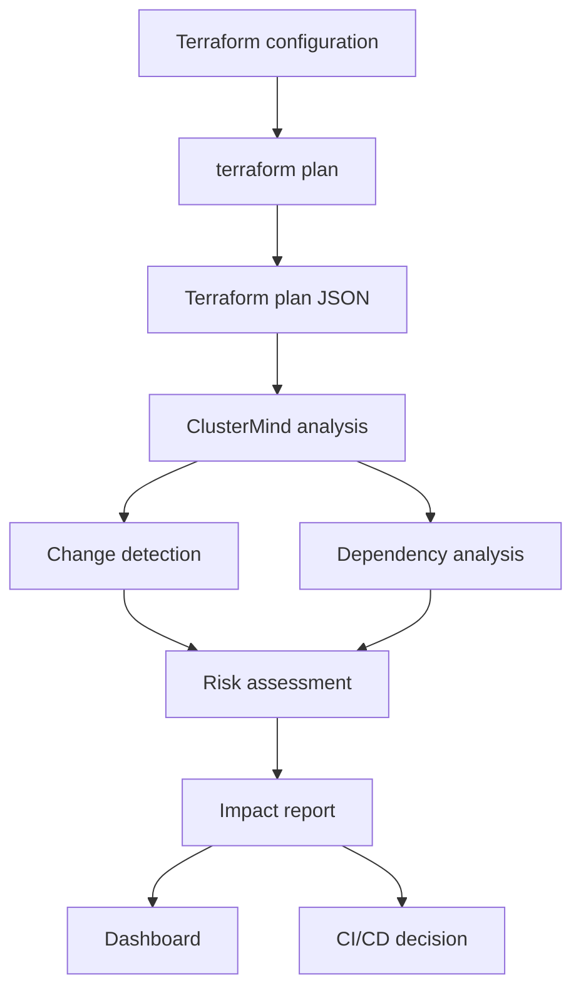
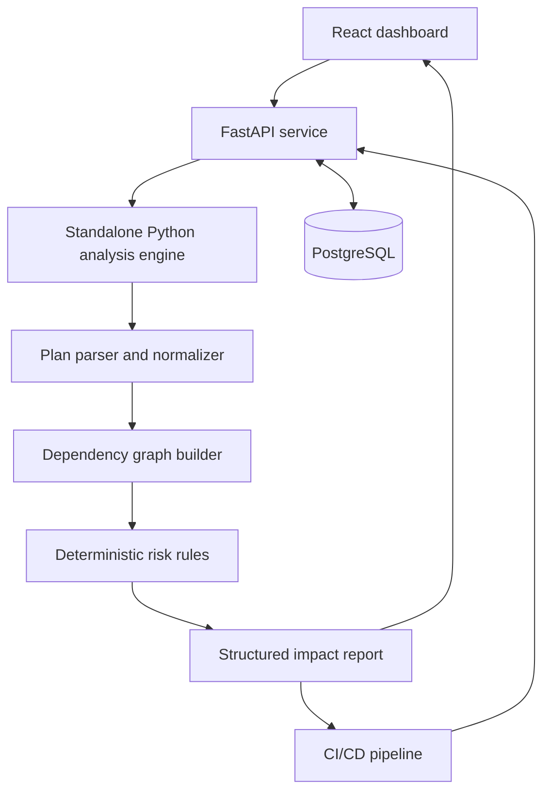

  

  <h1>ClusterMind</h1>
  
<strong>Understand infrastructure changes before they happen.</strong>

  
Terraform change intelligence · Dependency impact · CI/CD insights

What is ClusterMind?
ClusterMind is an open-source project exploring how Terraform plans can be turned into clear, explainable infrastructure impact reports.

ClusterMind
Infrastructure Change Intelligence for Terraform
Understand the potential impact of infrastructure changes before they are applied.

Overview · How it works · Architecture · Roadmap · Project boundaries

Project status: Early development. The architecture and MVP scope are being defined; features described below are planned and should not yet be considered implemented.

The goal is to help infrastructure, cloud, platform, and DevOps engineers make better-informed decisions before running terraform apply.
Why ClusterMind?
A plan can show that a subnet will be deleted. An engineer may still need to investigate which Terraform-managed resources reference that subnet and what else could be affected.

ClusterMind is being designed to help answer questions such as:
- What is changing, and which attributes are different?
- Which Terraform-managed resources depend on the changed resource?
- What direct and transitive relationships can be identified from the plan?
- Which changes deserve additional review?
- What evidence supports each finding, and what should an engineer check next?
ClusterMind is intended to complement Terraform's plan—not replace Terraform, CI/CD systems, or engineering review.
How it works
The MVP is centered on Terraform's machine-readable plan output.

Two workflows are planned, using the same analysis engine:
Dashboard analysis
1. An engineer creates or selects a project.
2. They upload a JSON plan generated with terraform show -json.
3. ClusterMind validates and analyzes the plan.
4. The dashboard presents resource changes, a dependency visualization, findings, evidence, and recommendations.
5. The analysis remains available for later review.
CI/CD analysis
1. A pipeline runs terraform plan and exports the plan as JSON.
2. The pipeline submits the JSON to the ClusterMind API.
3. ClusterMind analyzes the proposed changes and returns a structured result.
4. The pipeline uses its configured policy to continue, warn, request approval, or block the apply stage.
ClusterMind will not execute terraform apply or deploy infrastructure. The deployment decision and execution remain with the team's existing workflow.
Planned MVP capabilities
- Terraform plan parsing — validate and process Terraform's JSON plan format.
- Change detection — identify create, update, delete, and replacement actions, including attribute-level differences where available.
- Dependency analysis — build a graph from Terraform-declared references and dependency metadata.
- Impact exploration — highlight changed resources and trace direct or transitive declared dependencies.
- Explainable risk findings — report severity, confidence, evidence, and suggested review actions.
- Analysis history — retain safe, normalized results for later inspection and comparison.
- CI/CD API — make the same analysis engine available to automation pipelines.
- Infrastructure visualization — explore resources and their relationships through an interactive graph.
These are MVP objectives, not claims that the capabilities are already available.
Architecture
The intended design separates the analysis engine from the web application so that dashboard uploads and CI/CD requests use the same logic.

Technology direction
Area	Planned technology
Analysis engine	Python
Backend API	FastAPI and Pydantic
Dependency graph	NetworkX, if it remains a good fit
Frontend	React, TypeScript, and Vite
Infrastructure visualization	React Flow (@xyflow/react)
Persistence	PostgreSQL
Local development	Docker Compose
Testing	pytest and frontend tests/type checks

The stack may evolve as implementation reveals what is actually needed. The project will favor a small number of understandable components over unnecessary services.
Project boundaries and accuracy
ClusterMind's first iteration is deliberately Terraform-input-driven. It will not connect to a live cloud account to discover actual infrastructure state.

This means its findings must be precise about what the available data can establish:
- Declared relationship: represented by Terraform references or dependency metadata.
- Inferred relationship: suggested by available configuration or attributes, but not explicitly declared.
- Unknown relationship: not established from the available input.
Terraform data alone cannot reliably prove that an application is healthy, discover every undocumented runtime dependency, or guarantee that a proposed change will cause downtime. ClusterMind should communicate uncertainty and show the evidence behind each finding rather than present predictions as facts.

Security is also part of the design. Terraform plan files can contain sensitive values. The implementation must validate uploads, redact sensitive information, avoid retaining raw plans by default, and protect stored analysis data.
Roadmap
The initial development milestones are:
1. Terraform plan engine — fixtures, format validation, parsing, normalization, change detection, and tests.
2. Dependency and risk analysis — graph construction, impact traversal, explainable rules, and evidence.
3. Backend and persistence — API endpoints, analysis lifecycle, safe result storage, and access controls.
4. Dashboard and visualization — project overview, analysis details, interactive dependency graph, and findings.
5. CI/CD integration — API authentication, asynchronous analysis, result polling, and configurable pipeline decisions.
6. MVP release — end-to-end examples, documentation, security review, and a reproducible demo.
Progress and completed capabilities will be reflected here as the project develops.
Contributing
ClusterMind is intended to be an open-source engineering project. Contributions, issues, and thoughtful feedback will be welcome as the repository becomes ready for external contributors.

Before proposing a change, please check the project roadmap and open issues. Contribution and development setup instructions will be added as the first working version takes shape.
License
The planned license is MIT. A LICENSE file should be added to the repository before the first public release.

Built in the open for engineers who want to understand infrastructure changes before they apply.

